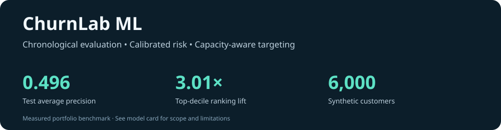

# ChurnLab ML

**Predict churn, audit the probabilities, and evaluate a limited contact budget.**

An AI-assisted portfolio implementation by **Vikas Reddy Konreddy**.



Python · scikit-learn · calibration · model selection · JavaScript inference · CI

## Why this project

A churn score becomes useful when an analyst can explain how it was validated,
whether its probabilities are trustworthy, and what a limited contact budget
would capture. This project follows that chain on a reproducible simulated
subscription cohort. It makes no claims about real customer retention uplift.

## Measured results

| Held-out synthetic test metric | Result |
|---|---:|
| Customers | 900 |
| Churn prevalence | 19.56% |
| Average precision | 0.496 |
| ROC AUC | 0.767 |
| Brier score | 0.130 |
| Precision among top 10% | 58.89% |
| Top-decile lift over prevalence | 3.01× |

Logistic regression won validation AP against a prevalence baseline and gradient
boosting. All numbers come from the committed [metrics](reports/metrics.json),
not invented client outcomes. A 3.01× ranking lift is **not** a 3.01× retention improvement.

## Reproduce and explore

Python 3.12 and Node 22 are used in CI. No API key or external data download.

```bash
python -m venv .venv
source .venv/bin/activate  # Windows: .venv\Scripts\activate
pip install -r requirements.txt
python -m churnlab.pipeline
python -m unittest discover -s tests -v
python build_report.py
node tests/parity.cjs
python -m http.server 8030 --bind 127.0.0.1
```

Open **http://127.0.0.1:8030**. Explore the capacity slider, model comparison,
calibration bins, permutation diagnostics, and a fictional-customer probability
calculator. The calculator runs the exported model locally in JavaScript.
The committed report is ready to serve without retraining.

## Evaluation design

1. Generate 6,000 unique fictional customer snapshots ordered by cohort time.
   Predict a simulated next-month outcome using six pre-outcome features.
2. Reserve the first 3,300 rows for model fitting, the next 900 for sigmoid
   calibration, the next 900 for model/threshold selection, and the last 900 for test.
3. Fit scaling on training data only. Compare a constant baseline, logistic
   regression and gradient boosting. Calibrate each candidate on the separate
   calibration partition using logistic regression over clipped probability logits.
4. Select the candidate by validation average precision and its decision threshold
   by validation F1. Use test labels only for final metrics and diagnostics.
5. Measure AP, ROC AUC, Brier, F1, capacity precision/recall/lift, reliability bins,
   and five-repeat permutation feature diagnostics.

The synthetic cohort includes gradual usage and outcome drift. Chronological
splitting is a leakage-control demonstration, not proof of real-world temporal
generalisation. No real dates or repeated customer records are present.

## Engineering checks

Six Python tests cover disjoint chronological partitions, reproducibility,
ranked targeting, budget rounding, threshold calculation and finite baseline
scores. A separate Node check compares browser predictions with Python for ten
held-out snapshots at a tolerance of 1e-10. CI retrains and runs both suites.

## Limitations and next steps

The data-generating process is intentionally learnable, so this benchmark cannot
establish performance on a real business population. Calibration can degrade
under drift; targeting is propensity-based and does not estimate treatment
effects. A production extension would require consented data, customer-level
time validation, uncertainty intervals, drift monitoring, and a randomised
retention experiment. The static calculator is exported only when logistic
regression wins; it is not a deployed customer decision service.

See [data card](DATA_CARD.md), [model card](MODEL_CARD.md), and
[source pipeline](churnlab/pipeline.py). Code is MIT licensed.
